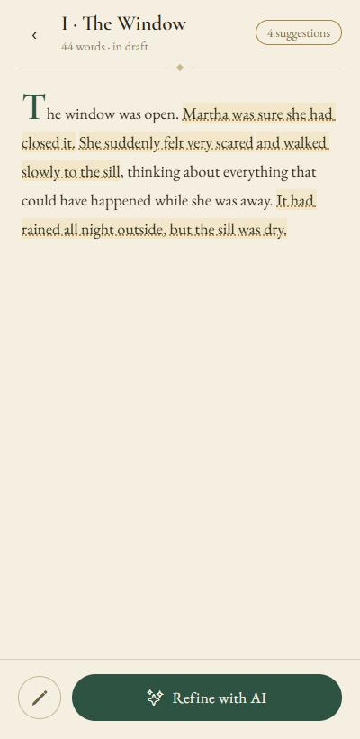
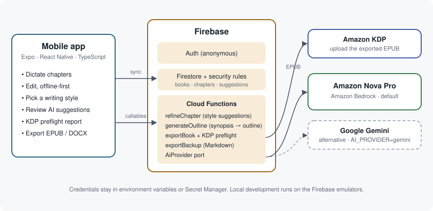

<p align="center"></p>

<p align="center"><a href="https://github.com/kalkal"></a></p>

# bookin3voice

Dictate a book out loud, get precise style suggestions from an AI, and export files that are
ready for Amazon KDP (EPUB and DOCX).

bookin3voice is a mobile app (React Native / Expo) backed by Firebase. Suggestions and chapter
outlines come from **Amazon Nova on Amazon Bedrock** by default; Google Gemini is available as
an alternative provider. Licensed under the [GNU AGPL v3.0 only](LICENSE), Copyright 2026 kalkal.

## Why it matters

Writing a book is mostly typing, and typing is what stops many people: a parent with a few spare
minutes on the commute, someone with a repetitive-strain injury, a person who thinks better
while walking. Speaking is faster and more natural, but raw dictation is messy. bookin3voice
closes the loop: you talk, it keeps the text safe (offline first, autosave, backups), an
editor-like AI points at the exact words worth changing and why, and a **KDP preflight check**
tells you what Amazon would reject before you upload.

## What it does

- **Dictation** per chapter with voice commands ("new paragraph"), live autosave and an
  offline-first store that syncs when the network comes back.
- **Style suggestions** anchored to exact spans of your text: category (style, grammar, pacing,
  history), a one-line reason, one to three proposals. **History** appears only when the text
  names a past period: period details that bring the scene to life and possible anachronisms,
  always as hints to check. You accept or reject each one. The AI never
  rewrites the chapter. Pick the style per book: **Suspense / Horror**, **Mystery (whodunit)**
  or **Thriller**.
- **Outline generator**: from a synopsis to a chapter-by-chapter outline you confirm.
- **KDP preflight check** before export: title and author, description length, empty chapters,
  blank table-of-contents entries, minimum length, and cover size and format when cover
  details are supplied (the app has no cover upload yet, so it warns that the cover is
  missing). Errors and warnings with clear messages; the server can also block the export
  (`strict`).
- **Export** to EPUB (checked with EPUBCheck, the W3C conformance checker) and DOCX, plus a Markdown
  backup of the raw text.
- Notes, daily word goals and streaks.
- English and Italian interface: the app follows the device language, or the language picked in
  Settings (`EXPO_PUBLIC_UI_LANG`
  forces one), and a new book is created in the interface language, which the AI uses.

<p>
  
  
  
</p>

*Screenshots of the app running on the Firebase emulators, with real suggestions
from Amazon Nova Pro in the Suspense / Horror style.*

## How it works



```
 Expo app (React Native, TypeScript)           Firebase (emulators locally)
 ┌──────────────────────────────┐   callable   ┌──────────────────────────────┐
 │ dictation · editor · review  │ ───────────▶ │ Cloud Functions (Node 20)    │
 │ offline-first repositories   │              │  refineChapter  generateOutline
 │ style picker · export tab    │ ◀─────────── │  exportBook (KDP preflight)  │
 └──────────────┬───────────────┘   results    │  exportBackup                │
                │ Firestore SDK                └───────┬──────────────┬───────┘
                ▼                                      │ AiProvider   │ Firestore
        Firestore + Auth (per-user rules)              ▼ port         ▼
                                              Amazon Nova (Bedrock)  users/{uid}/…
                                              or Gemini
```

- **Per-user data** lives under `users/{uid}/…`; security rules deny everything else and are
  covered by tests (`rules-tests/`).
- **One AI port.** `functions/src/ai/provider/` defines `AiProvider.generateJson(request)` that
  returns a value (`{ ok: true, value }` or `{ ok: false, error }`), never throws, and has a
  per-call timeout. Prompts, the JSON contract, validation (Zod) and the "exact span, found
  once" rule are shared by every provider.
- **Safe suggestions.** The model must quote the exact words it wants to change; the server
  discards anything that is absent or ambiguous in the text, caps the density and drops
  overlaps, so a suggestion can never be applied blindly.
- **Idempotent callables** keyed by `requestId`: a network retry never duplicates work or
  spends the AI budget twice.

Repository layout: `app/` Expo app · `functions/` Cloud Functions (AI, export, backup) ·
`content/style-profiles/` the style instructions and invented examples · `rules-tests/`
security-rules tests · `e2e/` Maestro flows · [`docs/local-development.md`](docs/local-development.md) emulator setup.

## AI provider

Default: **Amazon Nova Pro on Amazon Bedrock**, through the Converse API
(`@aws-sdk/client-bedrock-runtime`). Nova has no native JSON mode, so the answer is forced into
the JSON schema with a single tool and `toolChoice`; plain or fenced JSON text is also accepted.

| Variable | Meaning | Default |
| --- | --- | --- |
| `AI_PROVIDER` | `bedrock` or `gemini` | `bedrock` |
| `BEDROCK_MODEL_ID` | Bedrock model id or inference profile id | `amazon.nova-pro-v1:0` |
| `BEDROCK_MODEL_ID_OUTLINE` / `BEDROCK_MODEL_ID_FALLBACK` | optional outline model / fallback model | same as above / none |
| `BEDROCK_REGION` (or `AWS_REGION`) | AWS region | `us-east-1` |

The model id `amazon.nova-pro-v1:0` and its availability in `us-east-1` (in-region and through
the `us.amazon.nova-pro-v1:0` inference profile) are from the
[Amazon Bedrock model card for Nova Pro](https://docs.aws.amazon.com/bedrock/latest/userguide/model-card-amazon-nova-pro.html);
the model supports the Converse API and client-side tool calling, and allows up to 10K output
tokens. Check the card for the lifecycle status before you deploy: models are retired over time,
and newer Nova models can be selected by changing `BEDROCK_MODEL_ID` only.

**Choosing a model.** Nova Pro follows each style more closely.
Nova Lite (`amazon.nova-lite-v1:0`,
[model card](https://docs.aws.amazon.com/bedrock/latest/userguide/model-card-amazon-nova-lite.html))
is roughly 13 times cheaper per token and works too, with weaker suggestions; set
`BEDROCK_MODEL_ID` to use it. Current prices are on the
[Amazon Bedrock pricing page](https://aws.amazon.com/bedrock/pricing/).

**Credentials.** Standard AWS credentials, never in the code or the repository: environment
variables (`AWS_ACCESS_KEY_ID`, `AWS_SECRET_ACCESS_KEY`), a profile (`AWS_PROFILE`, including
SSO), or an IAM role. For the emulator put them in `functions/.secret.local`; in production
use Secret Manager (`firebase functions:secrets:set AWS_ACCESS_KEY_ID` and
`AWS_SECRET_ACCESS_KEY`; deployment declares both AWS secrets and `GEMINI_API_KEY`, so create
each one, with a dummy value for the provider you do not use).

**Minimum permission.** Create an IAM user (or role) that can only call the one model:

```json
{
  "Version": "2012-10-17",
  "Statement": [
    {
      "Effect": "Allow",
      "Action": "bedrock:InvokeModel",
      "Resource": "arn:aws:bedrock:us-east-1::foundation-model/amazon.nova-pro-v1:0"
    }
  ]
}
```

If you use an inference profile id (`us.amazon.nova-pro-v1:0`) also allow the profile ARN
(`arn:aws:bedrock:us-east-1:<account-id>:inference-profile/us.amazon.nova-pro-v1:0`) and the
foundation model in the destination regions. Depending on the account you may also have to
enable access to the model in the Bedrock console.

**Switch to Gemini.** Set `AI_PROVIDER=gemini`, put `GEMINI_API_KEY` in `functions/.secret.local`
(or Secret Manager) and choose the model names in `functions/.env` (`GEMINI_MODEL_*`). The
names in `functions/.env.example` are examples: check the current
[Gemini model list](https://ai.google.dev/gemini-api/docs/models) before you deploy.

Both providers share the same prompts, timeouts (80 s per call, 140 s for the outline; three attempts at most), error
classes (`throttled`, `timeout`, `blocked`, `truncated`, `invalid_json`, ...) and logging (no
prompt or text is ever logged).

## Writing styles

Defined in one place: `functions/src/ai/styles.ts` (ids and labels in English and Italian);
the instructions and the invented example sentences of each style are in
`content/style-profiles/<id>/`. The choice is stored per book (`styleProfileId`); an unknown
or missing value falls back to Suspense / Horror. No style imitates a real author.

| Style | What the suggestions look for |
| --- | --- |
| Suspense / Horror | tension from a threat not yet seen, sensory detail, body before mind |
| Mystery (whodunit) | camouflaged clues, red herrings, fair play, reveals that come too early |
| Thriller | concrete danger and a deadline, short sentences, cuts, cliffhangers |

To add a style: add a folder under `content/style-profiles/`, an entry in
`functions/src/ai/styles.ts` and in `app/src/features/books/styles.ts`; the tests check that
the new style has its own instructions and examples.

## Run it locally

Everything runs against the **Firebase Emulator Suite**, never a real project.

Prerequisites: Node 20+ (24 recommended), Java 21+ (for the emulators), `firebase-tools`
(`npm i -g firebase-tools`). On Windows the helper scripts are PowerShell; on macOS/Linux run
the commands inside them by hand.

```bash
# 1. install
(cd functions && npm ci) && (cd app && npm ci) && (cd rules-tests && npm ci)

# 2. configure the functions
cp functions/.env.example functions/.env          # then edit if needed
# put AWS credentials (or GEMINI_API_KEY) in functions/.secret.local, never in git

# 3. start the emulators (Auth, Firestore, Functions, Storage, UI on :4000)
npm --prefix functions run build && firebase emulators:start
#   Windows: cd app && npm run emulators

# 4. start the app (another terminal)
cd app && npx expo start
```

The project id in `.firebaserc` is `demo-bookvoice`: a `demo-` project never reaches the cloud.
To build the app against your own Firebase project, copy `app/.env.example` to `app/.env` and
fill in the `EXPO_PUBLIC_FIREBASE_*` values.

## Run the tests

```bash
# unit tests, no services needed
(cd functions && npm test)   # AI providers, styles, KDP preflight, exporters
(cd app && npm test)         # screens, repositories, state machines

# on the Firebase emulators (Java 21 + firebase-tools 14)
cp functions/.env.example functions/.env
(cd functions && npm run build)
firebase emulators:exec --only firestore --project demo-bookvoice "npm --prefix rules-tests run test:jest"
firebase emulators:exec --only firestore --project demo-bookvoice-functions "npm --prefix functions run test:integration"
firebase emulators:exec --only auth,firestore,functions --project demo-bookvoice-app "npm --prefix app run test:integration"
```

On Windows, `cd rules-tests && npm test` runs the rules suite through a PowerShell script.
The CI workflow runs the same commands.

The unit suites need no emulator, no network and no credentials. Integration tests use the
emulators; the EPUB checks use [EPUBCheck](https://github.com/w3c/epubcheck) (set `EPUBCHECK_JAR`
or place the jar in `tools/epubcheck/epubcheck.jar`). Tests that call a real model are skipped
unless credentials are present.

## What's next

- **Dictate your book hands-free with Alexa**: an Alexa skill that reads back the last chapter,
  tells you where you are in the book and saves short voice notes.

## License

[GNU AGPL v3.0 only](LICENSE), Copyright 2026 kalkal. Third-party code, fonts and data keep their own licenses (see [NOTICE](NOTICE) and `THIRD_PARTY_LICENSES.md`).
